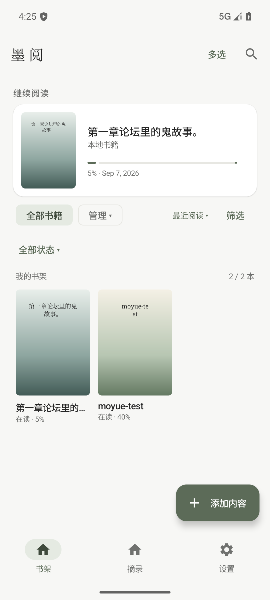
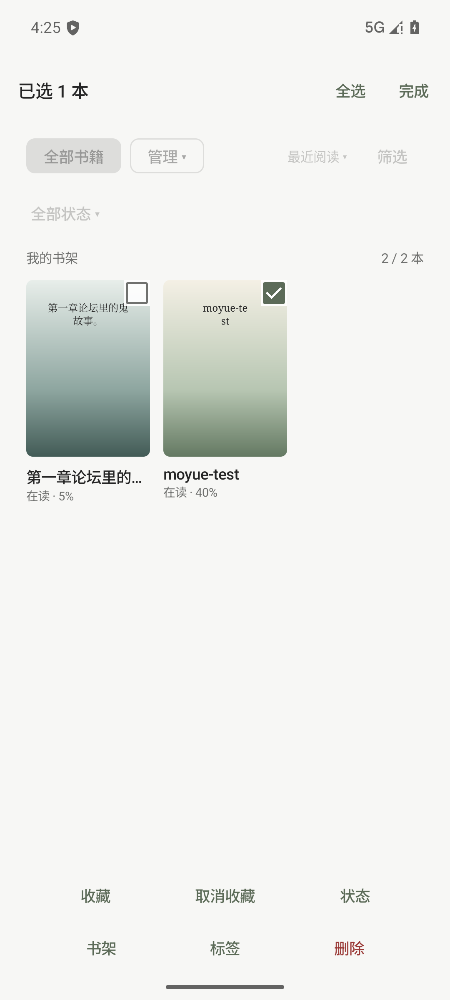

<div align="center">


# 墨阅 · Moyue

**把书留在身边，把阅读留给自己。**

一款原生 Android 阅读器，将电子书、文档、网页与漫画收进同一个书架。

[](https://github.com/fshfish88-lab/moyue/releases/latest)
[](#安装与更新)
[](#开发与构建)
[](#开发与构建)

**[下载 Android 版](https://github.com/fshfish88-lab/moyue/releases/latest)** · [查看更新](docs/v1.7.1-release.md) · [反馈问题](https://github.com/fshfish88-lab/moyue/issues)

[界面预览](#界面预览) · [功能亮点](#功能亮点) · [支持格式](#支持格式) · [快速开始](#快速开始) · [开发与构建](#开发与构建)

</div>

---

## 界面预览

浅色纸面、墨绿点缀，保留封面网格与「继续阅读」卡片。

<div align="center">
<table>
  <tr>
    <th>书架与继续阅读</th>
    <th>多选与批量管理</th>
  </tr>
  <tr>
    <td></td>
    <td></td>
  </tr>
</table>
<sub>V1.7.1 模拟器实际截图，含验收用示例书籍。</sub>
</div>

## 功能亮点

| | 让阅读与整理更顺手 |
| :--- | :--- |
| **📚 一个书架，多种内容** | 导入 TXT、EPUB、Markdown、PDF、图片与漫画，也可添加网页内容。 |
| **🌿 按自己的习惯阅读** | 文本支持滚动与左右分页，调整字体、字号与间距，切换日间、纸色、绿色、灰色和夜间配色。 |
| **🖍️ 留下阅读痕迹** | 高亮、笔记与位置书签；在摘录中心筛选、编辑、检索，返回原文或导出 Markdown。 |
| **🗂️ 自由整理书库** | 阅读状态与收藏独立，一本书可加入多个自定义书架、拥有多个标签，支持组合筛选与批量操作。 |
| **🔎 找回需要的内容** | 全局搜索覆盖书名、作者、小说目录及 Markdown／PDF 文档正文；摘录与笔记在摘录中心检索。 |
| **📥 从分享直接导入** | 接收其他应用分享的单个或多个文件，导入应用内副本；网页链接分享进入地址导入页。 |

### V1.7 · 更自由的书架

阅读到哪里、是否收藏、归入哪个书架，分别管理。

- **状态**：想读、在读、读完，可手动调整。旧书升级时按进度初始化一次，之后阅读进度不会覆盖手动状态。
- **收藏**：独立开关，可与阅读状态、自定义书架和其他条件叠加。
- **书架与标签**：支持新建、重命名、删除和多重归类；删除分类只移除关系，书籍仍在。
- **筛选**：顶部通过方块按钮选择书架、下拉列表选择状态，在筛选面板选择格式、作者、标签。多个标签需全部匹配；同一维度的格式、作者匹配任意一个，跨维度同时匹配。
- **排序**：最近阅读、导入时间、书名、作者、阅读进度；返回书架或重启后恢复筛选与排序偏好。
- **批量管理**：多选或全选当前筛选结果，批量调整收藏、状态、书架、标签，或确认后删除书籍。

长按一本书即可打开管理菜单，还可补录系列信息。本次优化见 [V1.7.1 更新说明](docs/v1.7.1-release.md)，书架管理说明见 [V1.7.0 更新说明](docs/v1.7.0-release.md)。

## 支持格式

| 内容 | 格式／来源 | 阅读与管理 |
| :--- | :--- | :--- |
| 电子书 | TXT、EPUB | 章节目录、滚动／分页阅读、高亮、笔记、书签 |
| Markdown | MD | 阅读与编辑、正文查找、标注 |
| PDF | PDF | 缩放、缩略图、页码跳转、文本标注与搜索 |
| 网页 | 网页地址 | 目录与正文抓取，已缓存正文可离线阅读及标注 |
| 静态图片 | JPG／JPEG、PNG、静态 WebP | 双指／双击缩放、旋转、适屏、适宽、位置书签与笔记 |
| 漫画 | CBZ、纯图片 ZIP | 自然页序、单页／连续阅读、缩略图、跳页、位置书签与笔记 |

> PDF 文本搜索与高亮依赖可提取的文字；图片与漫画使用位置书签和笔记。全局搜索不索引小说正文。

<details>
<summary>格式边界与图片归档限制</summary>

- 暂不支持 CBR、GIF、动态 WebP、Office 文档及混合文档 ZIP。
- 网页目录与正文按需抓取，需要网络；未缓存内容不能离线读取。
- 图片归档：源文件不超过 200 MiB，最多 2,000 个条目，单条目不超过 32 MiB，累计实际解压不超过 1 GiB。
- 图片尺寸：单边不超过 65,535 像素，总面积不超过 200 MP。
- 漫画缓存按需生成，限制为 8 页／96 MiB；无效图片、越界路径和重复路径会被拒绝。

</details>

## 安装与更新

支持 **Android 8.0 及以上**。

1. 打开 [最新发布页](https://github.com/fshfish88-lab/moyue/releases/latest)，下载 `Moyue-版本号.apk`。
2. 按系统提示允许当前下载来源安装应用，完成安装。
3. 已有墨阅的用户请**直接覆盖安装，不要卸载**，以保留书籍、进度与标注。

当前版本为 **V1.7.1**：[APK 下载](https://github.com/fshfish88-lab/moyue/releases/download/v1.7.1/Moyue-1.7.1.apk) · [源码包](https://github.com/fshfish88-lab/moyue/releases/download/v1.7.1/Moyue-1.7.1-source.zip) · [SHA256 校验文件](https://github.com/fshfish88-lab/moyue/releases/download/v1.7.1/SHA256.txt)

应用内可在「**设置 → 软件更新**」手动检查更新，也可开启自动检查。成功检查每天最多一次；下载后校验 SHA256、版本、包名与发布签名，再由用户确认安装。详见 [软件更新说明](docs/updates.md)。

## 快速开始

1. **添加内容**：在书架点击「添加内容」，选择文件或填写网页地址。
2. **分享导入**：在文件管理器等应用中选中文件，点击「分享 → 墨阅」。支持多文件；个别文件失败时会继续导入其余文件并给出提示。
3. **继续阅读**：从封面打开书籍，或点击顶部「继续阅读」卡片回到已保存位置。
4. **整理书库**：长按书籍设置状态、收藏、书架与标签；点击「多选」进行批量管理。
5. **回顾摘录**：在支持文本选择的阅读界面创建高亮与笔记，在「摘录」页检索并返回原文。

<details>
<summary>分享列表里没有墨阅？删除分类会丢书吗？</summary>

**分享列表里没有墨阅**

先确认已安装 V1.6.4 或更新版本，再在系统分享面板中滑动或展开完整应用列表。墨阅接收支持格式的单文件、多文件分享；发送方需提供可读取的文件权限。不同手机和发送应用的分享面板可能不同，具体表现需在对应设备上验证。

**删除书架或标签**

只删除分类关系，不删除书籍、进度和标注。删除书籍需明确确认，会清除应用内副本及相关记录；原始导入文件不受影响。

**数据与网络**

书库数据与阅读设置保存在应用内。网页抓取和 GitHub 更新检查需要网络；软件更新不会上传书籍或阅读记录。

</details>

## 开发与构建

原生 Kotlin + Jetpack Compose；Room 保存书库与分类关系，DataStore 保存阅读设置及筛选偏好。

| 项目 | 版本 |
| :--- | :--- |
| JDK | 17 |
| Android SDK | 36（最低 API 26） |
| Gradle Wrapper | 8.14.3 |
| Android Gradle Plugin | 8.13.0 |
| Kotlin | 2.2.21 |
| 应用包名 | `com.moyue.reader` |

克隆项目后，在工程根目录创建 `local.properties`，填写本机 SDK 路径。此文件不提交到 Git。

```properties
# 示例：请按本机安装位置调整
sdk.dir=D\:/Android Studio/Sdk
```

在工程根目录执行（Windows／PowerShell）：

```powershell
# 单元测试与静态检查
.\gradlew.bat testDebugUnitTest lintDebug

# 调试包与 Release 包
.\gradlew.bat assembleDebug assembleRelease
```

其他系统使用对应的 `./gradlew` 命令。调试 APK 位于 `app/build/outputs/apk/debug/`；`assembleRelease` 默认生成未签名 APK，正式发布需使用既有发布密钥，经 `zipalign`、`apksigner` 签名后才能覆盖安装官方旧版。

### 工程结构

```text
app/
├── src/main/java/com/moyue/reader/
│   ├── core/        # 数据、设置、存储与主题
│   ├── parser/      # 内容解析与导入
│   └── feature/     # 书架、阅读、摘录与设置
├── src/main/assets/ # 阅读器与文档相关资源
├── src/test/        # JVM 单元测试
├── src/androidTest/ # 设备端验证
└── schemas/         # Room 数据库版本
docs/                # 更新说明、验收记录与 README 图片
scripts/             # 发布辅助脚本
```

## 更新记录与验证

| 版本 | 主要变化 | 记录 |
| :--- | :--- | :--- |
| **V1.7.1** | 阅读状态与 EPUB 缓存优化、标注索引、书架方块与状态下拉、大目录查询修复 | [更新说明](docs/v1.7.1-release.md) · [验证记录](docs/v1.7.1-verification.md) |
| V1.7.0 | 独立状态与收藏、多书架与标签、组合筛选、排序、批量管理 | [更新说明](docs/v1.7.0-release.md) · [验证记录](docs/v1.7.0-verification.md) |
| V1.6.4 | 系统单文件与多文件分享导入 | [更新说明](docs/v1.6.4-release.md) · [验证记录](docs/v1.6.4-verification.md) |
| V1.6.3 | 分页与滚动交互修复、明确全局搜索范围 | [更新说明](docs/v1.6.3-release.md) · [验证记录](docs/v1.6.3-verification.md) |
| V1.6.2 | 阅读工具栏响应优化 | [更新说明](docs/v1.6.2-release.md) · [验证记录](docs/v1.6.2-verification.md) |
| V1.6.1 | 高亮显示与 PDF 标注修复 | [更新说明](docs/v1.6.1-release.md) · [验证记录](docs/v1.6.1-verification.md) |
| V1.6.0 | 统一标注、摘录中心与文本搜索 | [更新说明](docs/v1.6-release.md) · [验收记录](docs/v1.6-delivery.md) |

验证记录区分单元测试、模拟器和真机结果；以各版本记录中的实际执行范围为准。

## 反馈与参与

欢迎通过 [GitHub Issues](https://github.com/fshfish88-lab/moyue/issues) 提交问题或建议。反馈时请附上应用版本、Android 版本、文件格式、复现步骤，必要时提供可公开的最小样本。

相关实现使用 [Jetpack Compose](https://developer.android.com/compose)、[Room](https://developer.android.com/training/data-storage/room)、[DataStore](https://developer.android.com/topic/libraries/architecture/datastore)、[jsoup](https://jsoup.org/)、[ZoomImage](https://github.com/panpf/zoomimage)、[PDF.js](https://github.com/mozilla/pdf.js) 与 [MathJax](https://github.com/mathjax/MathJax)。第三方组件的许可声明随对应资源保留。

---

<div align="center">
<sub>墨阅 · 让书架有序，让阅读从容。</sub>
</div>
